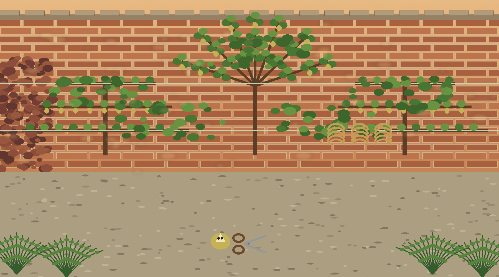
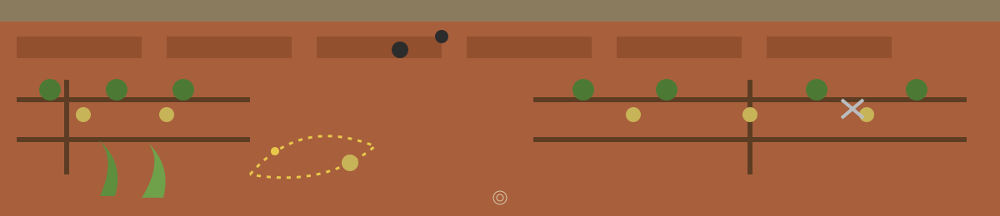

# Custom-Linux-AV





> CHECK ./virus BEFORE DELETING


A small Bash script (`custom.sh`) that runs one full-system ClamAV scan.
It updates the ClamAV virus definitions, then scans the whole filesystem
recursively and moves anything ClamAV detects into a quarantine folder
named `virus` in the current directory, so you decide what to do with
the detections.


<p align="center"></p>

<p class="plate"><sub>HERBARIUM LABEL 1 · ESPALIER WALL · pressed leaf ▪</sub></p>

## What the script does

Running `custom.sh` does exactly three things, in order:

1. `sudo freshclam` updates the ClamAV signature database.
2. `sudo mkdir -p virus` creates the quarantine folder (`./virus`,
   owned by root) if it is not already there.
3. `sudo clamscan -r --move=./virus /` recursively scans from the
   filesystem root and moves detected files into `./virus`.

That is the whole script. The only tool it uses is ClamAV.


<p align="center"></p>

<p class="plate"><sub>HERBARIUM LABEL 2 · ESPALIER WALL · pressed leaf ▪</sub></p>

## Exit codes and failure handling

- `0`: the scan ran and found nothing.
- `1`: the scan ran, found infected files, and moved them into
  `./virus`. A working scan that caught something, not a failure.
- `2`: the scan could not run or finish: `freshclam` or `clamscan`
  missing, the signature update failed on a machine with no existing
  signature database, the quarantine folder could not be created, or
  clamscan reported an error. If the update fails but signatures
  already exist, the script warns and scans with the older ones.
- `./custom.sh --help` prints the usage and these exit codes.

Tests: `python3 -m unittest` runs `test_custom.py`, which drives the
script with stub `sudo`, `freshclam`, and `clamscan` commands on PATH
and checks the exit code mapping. A real full-system scan was not run
as a test; that is the script's normal use, not a test step.


<p align="center"></p>

<p class="plate"><sub>HERBARIUM LABEL 3 · ESPALIER WALL · pressed leaf ▪</sub></p>

## Requirements

- A GNU/Linux system with Bash
- ClamAV installed, providing `freshclam` and `clamscan`
- `sudo` access, because the update, the quarantine folder, and the
  scan all run as root


<p align="center"></p>

<p class="plate"><sub>HERBARIUM LABEL 4 · ESPALIER WALL · pressed leaf ▪</sub></p>

## How to run

```sh
git clone https://github.com/Epsilon0xCell/Custom-Linux-AV.git
cd Custom-Linux-AV
chmod +x custom.sh
./custom.sh
```


<p align="center"></p>

<p class="plate"><sub>HERBARIUM LABEL 5 · ESPALIER WALL · pressed leaf ▪</sub></p>

## What it does not do

- It does not schedule itself. There is no cron job, systemd unit, or
  startup entry in this repo, so it runs only when you start it.
  Setting up a schedule is still a todo.
- It is not a rootkit scanner and includes no rootkit-specific tool.
  Detection is whatever ClamAV and its signatures catch.
- It has no realtime or on-access protection.


<p align="center"></p>

<p class="plate"><sub>HERBARIUM LABEL 6 · ESPALIER WALL · pressed leaf ▪</sub></p>

## Caution

A full-system scan with `--move` will move files ClamAV flags,
including system files if they are flagged, which can break an
installation if a detection is a false positive. Review the contents
of `./virus` before deleting anything, and note that the folder and
its contents are owned by root.


<p align="center"></p>

<p class="plate"><sub>HERBARIUM LABEL 7 · ESPALIER WALL · pressed leaf ▪</sub></p>

## Todo

- Setup cron


<p align="center"></p>

<p class="plate"><sub>HERBARIUM LABEL 8 · ESPALIER WALL · pressed leaf ▪</sub></p>

## License

MIT (see LICENSE).
