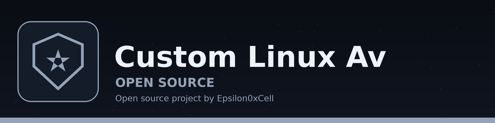

# Custom-Linux-AV

A small Bash script (`custom.sh`) that runs one full-system ClamAV scan.
It updates the ClamAV virus definitions, then scans the whole filesystem
recursively and moves anything ClamAV detects into a quarantine folder
named `virus` in the current directory, so you decide what to do with
the detections.

## What the script does

Running `custom.sh` does exactly three things, in order:

1. `sudo freshclam` updates the ClamAV signature database.
2. `sudo mkdir -p virus` creates the quarantine folder (`./virus`,
   owned by root) if it is not already there.
3. `sudo clamscan -r --move=./virus /` recursively scans from the
   filesystem root and moves detected files into `./virus`.

That is the whole script. The only tool it uses is ClamAV.

## Requirements

- A GNU/Linux system with Bash
- ClamAV installed, providing `freshclam` and `clamscan`
- `sudo` access, because the update, the quarantine folder, and the
  scan all run as root

## How to run

```sh
git clone https://github.com/Epsilon0xCell/Custom-Linux-AV.git
cd Custom-Linux-AV
chmod +x custom.sh
./custom.sh
```

## What it does not do

- It does not schedule itself. There is no cron job, systemd unit, or
  startup entry in this repo, so it runs only when you start it.
  Setting up a schedule is still a todo.
- It is not a rootkit scanner and includes no rootkit-specific tool.
  Detection is whatever ClamAV and its signatures catch.
- It has no realtime or on-access protection.

## Caution

A full-system scan with `--move` will move files ClamAV flags,
including system files if they are flagged, which can break an
installation if a detection is a false positive. Review the contents
of `./virus` before deleting anything, and note that the folder and
its contents are owned by root.

## Todo

- Setup cron

## License

MIT (see LICENSE).
